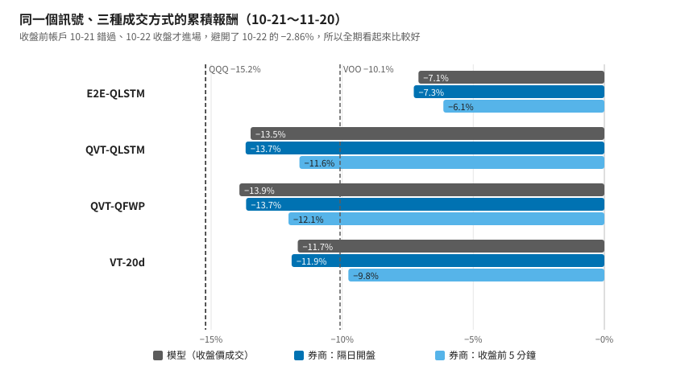
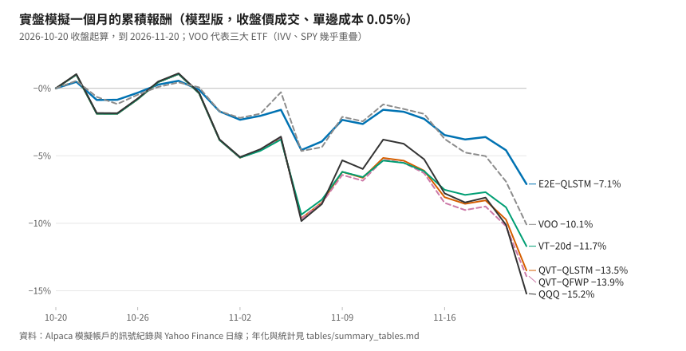
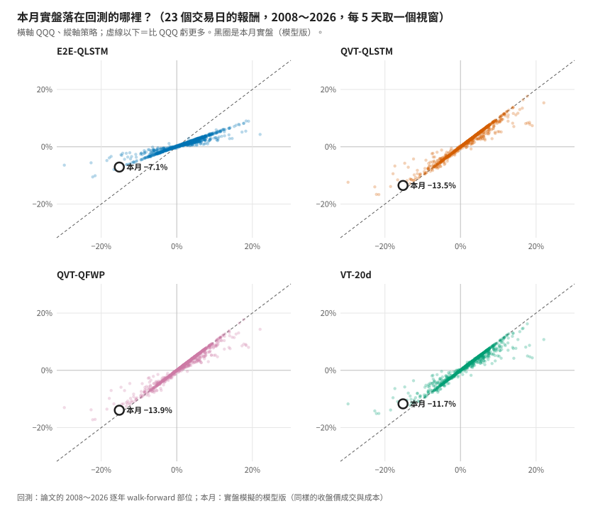
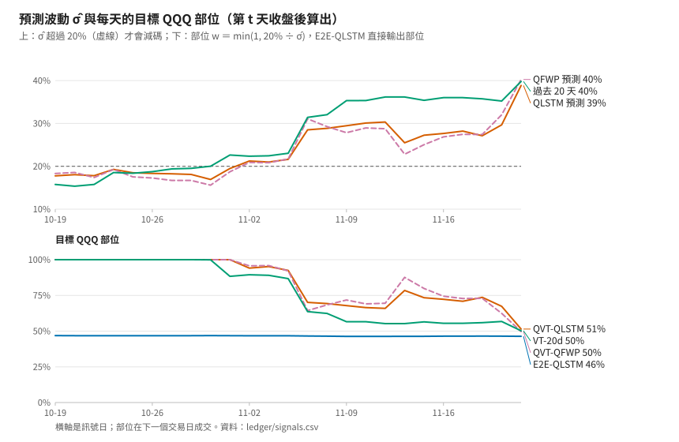
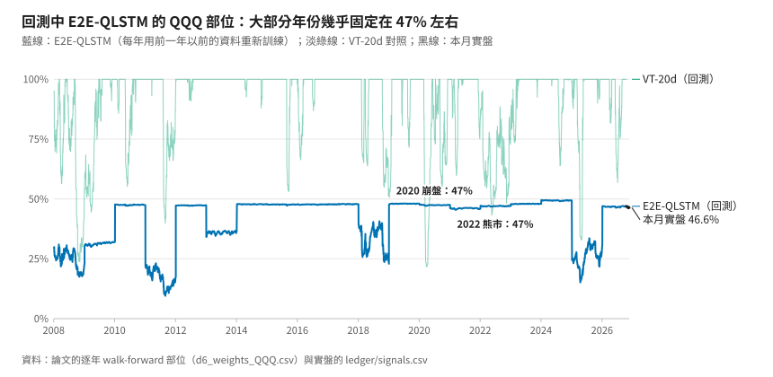

# 報告圖表（依講稿順序）

資料期間 2026-10-21～2026-11-20（紐約收盤），產生於 2026-11-23 14:51。本頁由 `analysis/make_report.py` 自動產生，數字和 `tables/summary_tables.md` 相同。圖是 SVG；如果看不清楚，每張圖下面都有 PNG 版。

1. [執行面驗證](#1-執行面驗證) · 2. [結果](#2-結果) · 3. [和論文的預期對照](#3-和論文的預期對照) · 4. [量子 vs 古典](#4-量子-vs-古典) · 5. [E2E-QLSTM 的部位](#5-e2e-qlstm-的部位)

## 1. 執行面驗證

講稿第 3 段。同一個訊號、三種成交方式。收盤前帳戶 10-21 錯過、10-22 收盤才進場，所以全期看起來比較好；「同起點」欄位是兩邊從同一天開始比。

[下載 PNG 版](figures/png/fig3_execution.png)

| 策略 | 帳戶 | 第一筆成交 | 全期：模型 | 全期：券商 | 全期差距 | 同起點 | 同起點：模型 | 同起點：券商 | 同起點差距 | 每日差距的年化標準差 |
|---|---|---|---|---|---|---|---|---|---|---|
| E2E-QLSTM | 券商：隔日開盤 | 2026-10-21 | -7.09% | -7.27% | -0.18% | 2026-10-22 | -7.54% | -7.45% | +0.09% | 1.0% |
| E2E-QLSTM | 券商：收盤前 5 分鐘 | 2026-10-22 | -7.09% | -6.14% | +0.95% | 2026-10-23 | -6.28% | -6.14% | +0.14% | 0.9% |
| QVT-QLSTM | 券商：隔日開盤 | 2026-10-21 | -13.50% | -13.68% | -0.19% | 2026-10-22 | -14.36% | -13.99% | +0.37% | 1.4% |
| QVT-QLSTM | 券商：收盤前 5 分鐘 | 2026-10-22 | -13.50% | -11.63% | +1.86% | 2026-10-23 | -11.84% | -11.61% | +0.23% | 0.6% |
| QVT-QFWP | 券商：隔日開盤 | 2026-10-21 | -13.92% | -13.67% | +0.25% | 2026-10-22 | -14.78% | -14.00% | +0.78% | 1.9% |
| QVT-QFWP | 券商：收盤前 5 分鐘 | 2026-10-22 | -13.92% | -12.05% | +1.87% | 2026-10-23 | -12.27% | -12.06% | +0.21% | 0.7% |
| VT-20d | 券商：隔日開盤 | 2026-10-21 | -11.70% | -11.93% | -0.23% | 2026-10-22 | -12.58% | -12.21% | +0.36% | 1.0% |
| VT-20d | 券商：收盤前 5 分鐘 | 2026-10-22 | -11.70% | -9.76% | +1.93% | 2026-10-23 | -10.00% | -9.77% | +0.24% | 0.6% |

各帳戶的訂單狀態：

| 帳戶 | 訂單數 | 成交 | 部分成交 | 過期 | 取消 | 拒絕 | 排隊中 |
|---|---|---|---|---|---|---|---|
| E2E-QLSTM-close | 30 | 30 | 0 | 0 | 0 | 0 | 0 |
| E2E-QLSTM | 39 | 35 | 0 | 2 | 0 | 0 | 2 |
| QVT-QFWP-close | 39 | 39 | 0 | 0 | 0 | 0 | 0 |
| QVT-QFWP | 40 | 38 | 0 | 0 | 0 | 0 | 2 |
| QVT-QLSTM-close | 42 | 38 | 0 | 2 | 2 | 0 | 0 |
| QVT-QLSTM | 42 | 38 | 0 | 2 | 0 | 0 | 2 |
| VT-20d-close | 38 | 38 | 0 | 0 | 0 | 0 | 0 |
| VT-20d | 38 | 36 | 0 | 0 | 0 | 0 | 2 |

## 2. 結果

講稿第 4 段。模型版＝收盤價成交、單邊成本 0.05%，和論文回測的算法相同。

[下載 PNG 版](figures/png/fig1_cumulative.png)

| 策略 | 執行方式 | 天數 | 累積報酬 | 年化波動 | 波動÷QQQ | 虧損÷QQQ 虧損 | 最大回撤 | 最差一天 |
|---|---|---|---|---|---|---|---|---|
| E2E-QLSTM | 模型（收盤價成交） | 23 | -7.09% | 17.8% | 0.47 | 0.47 | -7.6% | -3.03% |
| E2E-QLSTM | 券商：隔日開盤 | 23 | -7.27% | 17.2% | 0.45 | 0.48 | -7.5% | -2.80% |
| E2E-QLSTM | 券商：收盤前 5 分鐘 | 23 | -6.14% | 16.8% | 0.44 | 0.40 | -7.5% | -2.84% |
| QVT-QLSTM | 模型（收盤價成交） | 23 | -13.50% | 33.0% | 0.86 | 0.89 | -14.4% | -6.18% |
| QVT-QLSTM | 券商：隔日開盤 | 23 | -13.68% | 31.8% | 0.83 | 0.90 | -14.0% | -6.00% |
| QVT-QLSTM | 券商：收盤前 5 分鐘 | 23 | -11.63% | 31.3% | 0.82 | 0.76 | -14.2% | -6.14% |
| QVT-QFWP | 模型（收盤價成交） | 23 | -13.92% | 33.0% | 0.86 | 0.91 | -14.8% | -6.22% |
| QVT-QFWP | 券商：隔日開盤 | 23 | -13.67% | 31.7% | 0.83 | 0.90 | -14.1% | -6.01% |
| QVT-QFWP | 券商：收盤前 5 分鐘 | 23 | -12.05% | 31.3% | 0.82 | 0.79 | -14.6% | -6.18% |
| VT-20d | 模型（收盤價成交） | 23 | -11.70% | 30.1% | 0.79 | 0.77 | -12.6% | -5.78% |
| VT-20d | 券商：隔日開盤 | 23 | -11.93% | 29.2% | 0.76 | 0.78 | -12.3% | -5.62% |
| VT-20d | 券商：收盤前 5 分鐘 | 23 | -9.76% | 28.3% | 0.74 | 0.64 | -12.4% | -5.73% |
| VOO | 買進持有 | 23 | -10.08% | 24.3% | 0.64 | 0.66 | -10.6% | -4.37% |
| IVV | 買進持有 | 23 | -10.18% | 24.6% | 0.64 | 0.67 | -10.7% | -4.41% |
| SPY | 買進持有 | 23 | -10.30% | 24.8% | 0.65 | 0.68 | -10.8% | -4.41% |
| QQQ | 買進持有 | 23 | -15.21% | 38.2% | 1.00 | 1.00 | -16.1% | -6.49% |

## 3. 和論文的預期對照

講稿第 5 段。先看事先登記的 4 個預期，再看本月落在回測同類下跌的哪裡。

| 預期 | 結果 | 判定 |
|---|---|---|
| 量子策略與 VT-20d 的實際波動 ≤ QQQ | 16.8%～33.0%，QQQ 38.2% | 符合 |
| E2E-QLSTM 的波動約為 QQQ 的 40%～50% | 47%、45%、44% | 符合 |
| 波動 < 20% 時三個 VT 策略都持有 100%、報酬相同；波動上升才分開 | 三者都 100% 的執行日 7 天（10-21, 10-22, 10-23, 10-26, 10-27, 10-28, 10-29），這些天報酬完全相同；之後 σ̂ 超過 20% 才分開 | 符合 |
| 券商與模型的差距遠小於策略之間的差異 | 開盤帳戶全期差距最大 0.25%；同起點差距最大 0.78%；策略之間最大 6.83% | 符合 |

[下載 PNG 版](figures/png/fig4_backtest_windows.png)

回測 2008～2026 中，QQQ 在 23 個交易日內跌超過 10% 的視窗有 170 個（彼此重疊，約 18 段獨立的下跌）：

| 策略 | 回測：少虧於 QQQ 的比例 | 回測：少虧於 SPY 的比例 | 回測：虧損÷QQQ 虧損（中位數） | 回測：10%～90% 區間 | 本月實盤：虧損÷QQQ 虧損 | 本月在回測分布的百分位 | 本月少虧於 SPY |
|---|---|---|---|---|---|---|---|
| E2E-QLSTM | 100% | 100% | 0.43 | 0.17～0.48 | 0.47 | 58% | 是 |
| QVT-QLSTM | 97% | 56% | 0.82 | 0.39～0.97 | 0.89 | 66% | 否 |
| QVT-QFWP | 97% | 57% | 0.81 | 0.41～0.97 | 0.91 | 75% | 否 |
| VT-20d | 98% | 64% | 0.73 | 0.39～0.95 | 0.77 | 59% | 否 |

## 4. 量子 vs 古典

講稿第 6 段。

[下載 PNG 版](figures/png/fig2_sigma_weight.png)

- 從 2026-10-29 起（過去 20 天波動超過 20%）：QLSTM、QFWP 預測的 σ̂ 平均比過去 20 天波動低 4.9、5.3 個百分點；部位平均比 VT-20d 多 10.3、11.3 個百分點，最多多 32.4 個百分點。
- 累積報酬（模型版）：VT-20d -11.70%，QVT-QLSTM -13.50%，QVT-QFWP -13.92%。

## 5. E2E-QLSTM 的部位

講稿第 7 段。本月和回測都顯示，E2E-QLSTM 大部分時間的部位幾乎固定。

[下載 PNG 版](figures/png/fig5_e2e_weight.png)

- 本月：目標部位 46.3%～46.9%（平均 46.6%）。同期固定持有 46.6% QQQ、其餘 BIL：累積 -7.07%、波動 17.8%、最大回撤 -7.6%；E2E-QLSTM（模型版）是 -7.09%、17.8%、-7.6%。
- 回測 2008～2026：E2E-QLSTM 的部位平均 41.3%、標準差 10.1%、1%～99% 分位 13.0%～49.5%；和 VT-20d 部位的相關 0.30。固定比例的全期數字在下表最後一列。
- 意思：本月「只虧 QQQ 的一半」幾乎完全來自平均只持有約 47% 的 QQQ，不是 E2E 在下跌時減碼。

固定比例對照（全期）：

| 策略 | 期間 | CAGR | 年化波動 | CAGR÷波動 | 最大回撤 |
|---|---|---|---|---|---|
| E2E-QLSTM | 2008-01-02～2026-10-19 | 8.6% | 8.8% | 0.97 | -17.0% |
| QVT-QLSTM | 2008-01-02～2026-10-19 | 15.4% | 18.2% | 0.85 | -32.7% |
| QVT-QFWP | 2008-01-02～2026-10-19 | 15.0% | 18.0% | 0.83 | -33.9% |
| VT-20d | 2008-01-02～2026-10-19 | 15.5% | 17.3% | 0.90 | -32.6% |
| QQQ | 2008-01-02～2026-10-19 | 16.1% | 22.4% | 0.72 | -49.4% |
| SPY | 2008-01-02～2026-10-19 | 11.2% | 19.7% | 0.57 | -51.9% |
| 固定 41% QQQ＋國庫券（事後用 E2E 的平均部位） | 2008-01-02～2026-10-19 | 7.9% | 9.2% | 0.85 | -23.3% |

每年的部位（排除每年頭兩個交易日，那兩天還是前一年模型的部位）：

| 年 | 平均部位 | 最低 | 最高 | 最高−最低 | QQQ 當年報酬 | E2E 當年報酬 |
|---|---|---|---|---|---|---|
| 2008 | 24.7% | 17.5% | 31.0% | 13.5 pt | -41.7% | -10.8% |
| 2009 | 31.3% | 29.9% | 32.1% | 2.1 pt | 54.7% | 15.0% |
| 2010 | 47.5% | 47.1% | 47.7% | 0.6 pt | 20.1% | 9.4% |
| 2011 | 17.0% | 9.5% | 23.1% | 13.6 pt | 3.5% | 0.8% |
| 2012 | 47.3% | 47.1% | 47.4% | 0.3 pt | 18.1% | 7.8% |
| 2013 | 36.0% | 34.1% | 36.8% | 2.6 pt | 36.6% | 12.3% |
| 2014 | 47.8% | 47.6% | 48.0% | 0.4 pt | 19.2% | 9.2% |
| 2015 | 47.7% | 47.2% | 47.8% | 0.6 pt | 9.4% | 4.8% |
| 2016 | 47.7% | 47.5% | 47.9% | 0.4 pt | 7.1% | 3.8% |
| 2017 | 47.8% | 47.6% | 48.0% | 0.3 pt | 32.7% | 15.2% |
| 2018 | 32.7% | 23.6% | 40.7% | 17.1 pt | -0.1% | 2.5% |
| 2019 | 48.0% | 47.7% | 48.1% | 0.4 pt | 39.0% | 19.6% |
| 2020 | 47.4% | 47.1% | 47.7% | 0.6 pt | 48.4% | 22.8% |
| 2021 | 46.1% | 45.4% | 46.3% | 0.9 pt | 27.4% | 12.3% |
| 2022 | 47.0% | 46.8% | 47.3% | 0.5 pt | -32.6% | -15.0% |
| 2023 | 47.9% | 47.8% | 48.1% | 0.3 pt | 54.9% | 27.1% |
| 2024 | 49.4% | 49.0% | 49.6% | 0.6 pt | 25.6% | 15.2% |
| 2025 | 25.8% | 15.1% | 33.6% | 18.5 pt | 20.8% | 8.4% |
| 2026 | 46.8% | 46.3% | 47.1% | 0.8 pt | 17.6% | 9.9% |

每年的訓練情況（`d6_lr_choice.csv`，只讀）：19 年中有 12 年選中最小的學習率 0.005，其中 10 年早停選在前 3 個 epoch，這些年的部位都在 46.1%～49.4%；選中較大學習率的 7 年，部位 17.0%～47.3%。實盤用的 2026 年模型：學習率 0.005，早停平均在第 2.7 個 epoch。這只是描述；「部位水準接近初始值」是推測，還沒有用未訓練的模型驗證。

| 測試年 | 選中的學習率 | 早停選中的 epoch（10 個種子平均） | 實際跑的 epoch | 測試年平均部位 |
|---|---|---|---|---|
| 2008 | 0.02 | 21.7 | 24.0 | 24.6% |
| 2009 | 0.05 | 4.9 | 9.9 | 31.3% |
| 2010 | 0.005 | 7.4 | 11.5 | 47.5% |
| 2011 | 0.05 | 11.5 | 16.1 | 17.0% |
| 2012 | 0.05 | 1.8 | 6.8 | 47.3% |
| 2013 | 0.05 | 4.6 | 9.6 | 36.0% |
| 2014 | 0.005 | 2.3 | 7.3 | 47.8% |
| 2015 | 0.005 | 1.0 | 6.0 | 47.7% |
| 2016 | 0.005 | 1.3 | 6.3 | 47.7% |
| 2017 | 0.005 | 1.7 | 6.7 | 47.8% |
| 2018 | 0.05 | 14.4 | 18.8 | 32.6% |
| 2019 | 0.005 | 1.5 | 6.5 | 48.0% |
| 2020 | 0.005 | 1.0 | 6.0 | 47.4% |
| 2021 | 0.005 | 4.1 | 9.1 | 46.1% |
| 2022 | 0.005 | 1.7 | 6.7 | 47.0% |
| 2023 | 0.005 | 1.6 | 6.6 | 47.9% |
| 2024 | 0.005 | 2.2 | 7.2 | 49.4% |
| 2025 | 0.05 | 4.1 | 9.1 | 25.9% |
| 2026 | 0.005 | 2.7 | 7.7 | 46.8% |

