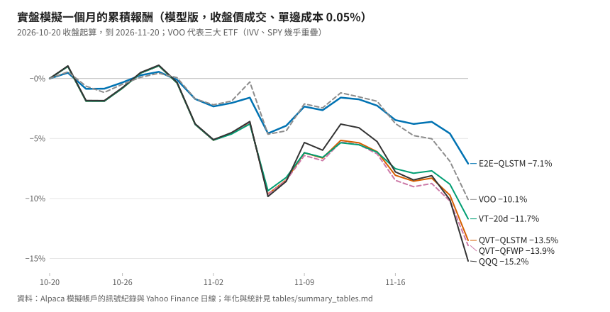
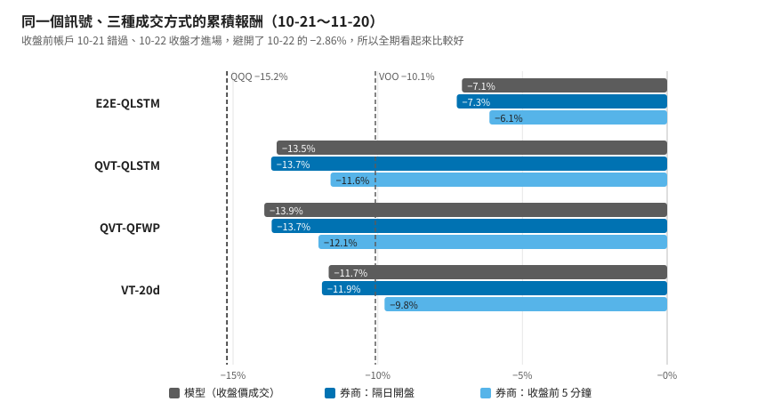
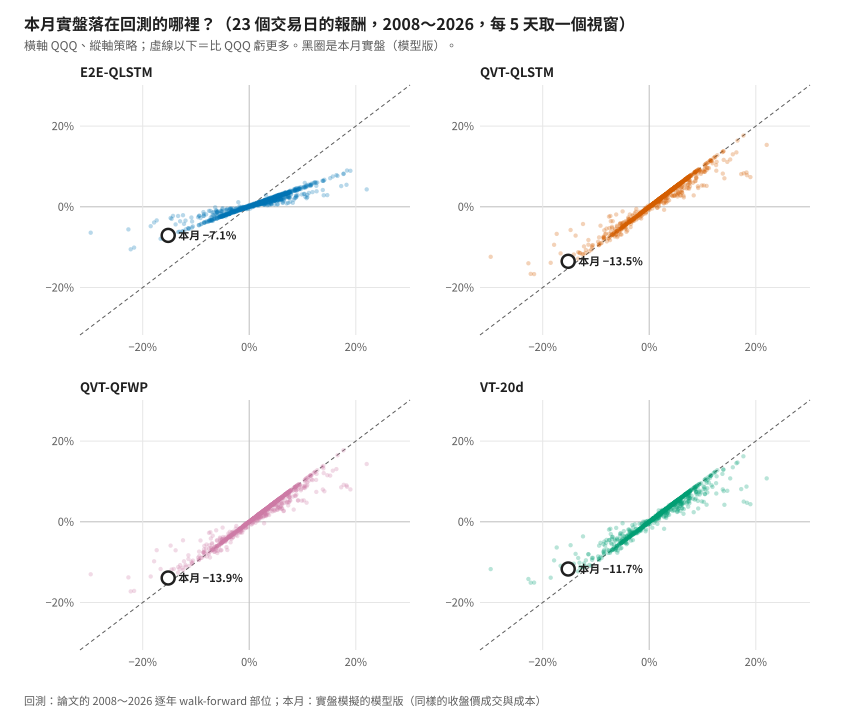
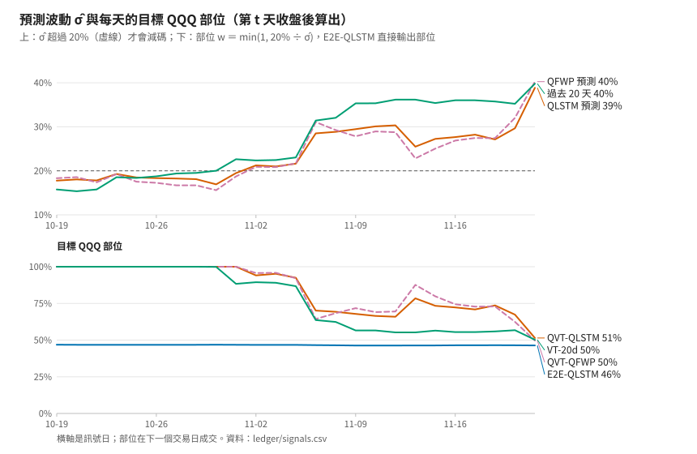

# RECORDED-DATA：論文策略的實盤模擬紀錄

論文 *Quantum Volatility Forecasting for Volatility-Targeted Trading* 的策略，用 Alpaca 模擬帳戶在真實時間下執行的前瞻測試（forward test）紀錄。


- **報告圖表：[`FIGURES.md`](FIGURES.md)**
- 延伸研究摘要：[`EXTENSIONS.md`](EXTENSIONS.md)
- 所有自動產生的表格：[`tables/summary_tables.md`](tables/summary_tables.md)

---

## 1. 目前狀況

| 項目 | 狀況 |
|---|---|
| 事先登記 | [`PROTOCOL.md`](PROTOCOL.md)：2026-10-21 第一筆模擬單送出前寫好，之後的修改都寫在最後的變更紀錄。模型與程式的 SHA-256 在 `data/freeze.json`，每次執行都會核對。 |
| 主要觀察期（21 個交易日） | **已完成**：開盤帳戶 10-21～11-18，收盤前帳戶 10-22～11-19。 |
| 延長樣本 | 雲端照常自動執行到 **2026-12-15**，這段之後另外報告。 |
| 資料完整性 | 10-21～11-20 的 23 個交易日每天都有紀錄。4 個策略共 100 個訊號，沒有錯過。設定期（10-20～10-21）之後的訂單全部成交。 |
| 執行上出過的事 | 10-20：Alpaca 模擬帳戶不撮合市價收盤單，第一批單全部過期。10-21：GitHub 排程延遲約 3 小時，4 個收盤前帳戶錯過一天。之後改由 cron-job.org 準時觸發，沒有再發生。|
| 接下來的特殊交易日 | 11-26 感恩節休市；11-27 提早在 13:00 收盤，收盤前的送單時段已改成 12:05～12:57。 |

### 策略與帳戶

全部不加槓桿，只持有 QQQ，其餘資金放短期國庫券 ETF（BIL）。

| 策略 | 每天的 QQQ 部位 w | 用到量子模型 |
|---|---|---|
| E2E-QLSTM | QLSTM 直接輸出部位（10 個種子平均） | 是 |
| QVT-QLSTM | min(1, 20% ÷ σ̂)，σ̂ 是 QLSTM 預測的未來 20 天波動 | 是 |
| QVT-QFWP | 同上，σ̂ 改用 QFWP 預測 | 是 |
| VT-20d | min(1, 20% ÷ 過去 20 天波動) | 否（古典對照） |

- 每個策略有兩個 Alpaca 模擬帳戶，各 10 萬美元，一共 8 個：
  - **隔日開盤**：第 t 天收盤後算出部位，下一個交易日開盤成交；
  - **收盤前 5 分鐘**：下一個交易日 15:55 送市價單，成交價接近收盤價。
- **模型版**：同樣的訊號，用收盤價成交、單邊成本 0.05%，和論文回測的算法相同。
- 模型是論文 2026 年 fold 的模型（訓練資料到 2024 年），觀察期間不重新訓練。

## 2. 結果（10-21～11-20，23 個交易日）

這段期間 QQQ 跌了 15.2%，VOO、IVV、SPY 跌了 10.1%～10.3%。

| 策略 | 模型版 | 券商：隔日開盤 | 券商：收盤前 5 分鐘 | 年化波動 | 最大回撤 | 虧損 ÷ QQQ 虧損 |
|---|---|---|---|---|---|---|
| E2E-QLSTM | **−7.09%** | −7.27% | −6.14% | 17.8% | −7.6% | **0.47** |
| QVT-QLSTM | −13.50% | −13.68% | −11.63% | 33.0% | −14.4% | 0.89 |
| QVT-QFWP | −13.92% | −13.67% | −12.05% | 33.0% | −14.8% | 0.91 |
| VT-20d | −11.70% | −11.93% | −9.76% | 30.1% | −12.6% | 0.77 |
| VOO 買進持有 | −10.08% | | | 24.3% | −10.6% | 0.66 |
| IVV 買進持有 | −10.18% | | | 24.6% | −10.7% | 0.67 |
| SPY 買進持有 | −10.30% | | | 24.8% | −10.8% | 0.68 |
| QQQ 買進持有 | −15.21% | | | 38.2% | −16.1% | 1.00 |

年化波動、最大回撤、虧損比都是模型版的數字。

- **4 個策略都比 QQQ 少虧**。E2E-QLSTM 只虧了 QQQ 的一半左右，是唯一贏過 VOO、IVV、SPY 的策略。三個波動度目標策略比 QQQ 少虧，但比三大 ETF 多虧。
- **執行差距很小**：開盤帳戶和模型版差 −0.23～+0.25 個百分點。收盤前帳戶全期看起來好 1～2 個百分點，原因是它們 10-22 收盤才進場，剛好避開那天 QQQ 的 −2.86%。用相同起點比較時，差距只有 +0.14～+0.24 個百分點。
- **成交價**：開盤成交平均比 Yahoo 開盤價差 5.8 bp（對自己不利）；收盤前 5 分鐘的成交平均和官方收盤價差 −0.3 bp，最大 40 bp。





## 3. 和論文的預期對照

### 事先登記的 4 個預期（全部符合）

| 預期 | 結果 |
|---|---|
| 量子策略與 VT-20d 的實際波動 ≤ QQQ | 16.8%～33.0%，QQQ 是 38.2% |
| E2E-QLSTM 的波動約為 QQQ 的 40%～50% | 模型版、開盤、收盤前分別是 47%、45%、44% |
| 波動 < 20% 時，三個波動度目標策略都持有 100%，報酬相同；波動上升後才分開 | 10-21～10-29 這 7 天都是 100%，報酬完全相同；σ̂ 超過 20% 之後才分開 |
| 券商和模型的差距遠小於策略之間的差異 | 執行差距最多 0.78 個百分點，策略之間差 6.83 個百分點 |

### 和回測的同類下跌比

用論文的回測部位（2008～2026）重建每日報酬，找出所有「QQQ 在 23 個交易日內跌超過 10%」的視窗：共 170 個，彼此重疊，大約是 18 段獨立的下跌。

| 策略 | 回測：少虧於 QQQ | 回測：少虧於 SPY | 回測：虧損 ÷ QQQ（中位數，10%～90%） | 本月 | 本月在回測分布的位置 |
|---|---|---|---|---|---|
| E2E-QLSTM | 100% | 100% | 0.43（0.17～0.48） | 0.47 | 第 58 百分位 |
| QVT-QLSTM | 97% | 56% | 0.82（0.39～0.97） | 0.89 | 第 66 百分位 |
| QVT-QFWP | 97% | 57% | 0.81（0.41～0.97） | 0.91 | 第 75 百分位 |
| VT-20d | 98% | 64% | 0.73（0.39～0.95） | 0.77 | 第 59 百分位 |

**本月的結果完全落在回測的典型範圍內。** 回測裡，QVT 在 QQQ 急跌時也只有大約一半的時候贏 SPY，所以本月 QVT 輸給三大 ETF 並不意外。



### 也對上了延伸研究的發現

- **量子模型減碼比較慢**：10-29 之後（過去 20 天波動超過 20% 起），QLSTM、QFWP 預測的 σ̂ 平均比過去 20 天的實際波動低約 5 個百分點，部位平均高 10～11 個百分點，最多高 32 個百分點（QFWP，11-12）。所以 VT-20d 比兩個量子 QVT 少虧 1.8～2.2 個百分點。這和 `DECISION_VOL` 找到的「log 尺度訓練造成波動低估」一致，也和論文「優勢來自波動度管理，不是量子」的結論一致。
- **E2E-QLSTM 的部位整個月幾乎沒動**，一直在 46.3%～46.9%。同期固定持有 46.6% QQQ、其餘放 BIL 的組合是 −7.07%，E2E 是 −7.09%。也就是說，本月少虧幾乎完全來自「只持有一半」，不是擇時。回測裡 19 年有 15 年，E2E 年內的部位高低差不到 3 個百分點（`tables/e2e_weight_by_year.csv`）。



## 4. 不能從這份資料下的結論

- 只有 23 個交易日，任何績效差異都沒有統計意義。`PROTOCOL.md` 事先就寫明這次只做描述。
- 這個月是科技股領跌（QQQ −15%，SPY −10%），只看得到「下跌時的保護」，看不到上漲時少賺的代價。
- 論文說的「勝過三大 ETF」是 2008～2026 長期、風險調整後的結果（QVT-QLSTM 的 CAGR÷波動 0.85，SPY 0.57），一個月沒辦法驗證。
- 4 個策略是同一個標的、同一段時間，彼此高度相關，不是 4 次獨立的驗證。
- Alpaca 的模擬成交沒有真實的市場衝擊和排隊。收盤前帳戶用 15:55 的市價單代替收盤單。

## 5. 資料夾內容

```
README.md                 本檔：目前狀況
FIGURES.md                報告用的圖表與表格（自動產生）
EXTENSIONS.md             延伸研究摘要
PROTOCOL.md               事先登記的規則與變更紀錄（雲端 repo 原檔的副本）
data/                     雲端 repo 的原始紀錄（副本）
  daily_returns.csv       每天的報酬：4 個模型版、8 個券商帳戶、4 個 ETF
  signals.csv             每天的 σ̂、目標部位、成交日、是否錯過
  orders.csv              程式送出的每一張單
  broker_orders/          8 個帳戶在券商端的訂單與成交（成交價、成交時間）
  account_snapshots.csv   每次執行時的帳戶淨值、現金、持股
  cloud_runs.log          雲端每次執行的紀錄
  freeze.json             模型與程式的 SHA-256
  summary_auto.md         雲端自動產生的摘要
tables/                   由 analysis/make_report.py 算出
  summary_tables.md       全部表格（第 1～8 節）
  performance.csv         績效
  execution_gap.csv       券商和模型的差距
  fill_vs_reference.csv   每筆 QQQ 成交價和官方開盤／收盤價的偏離
  order_status.csv        每個帳戶的訂單狀態
  preregistered_expectations.csv  事先登記的預期對照
  sigma_and_weights.csv   每天的 σ̂ 與部位
  backtest_23d_windows.csv  和回測同類下跌的比較
  e2e_weight_by_year.csv  回測中 E2E-QLSTM 每年的部位
  e2e_training_by_year.csv  回測中 E2E-QLSTM 每年選中的學習率與早停 epoch
figures/                  5 張 SVG 圖；png/ 是同樣的圖（2 倍解析度 PNG）
analysis/make_report.py   產生 data/ 副本、tables/、figures/、FIGURES.md
extensions/               延伸研究的完整結果報告（副本）
```

不包含的東西：
- 券商金鑰（`config.env`）；
- 帳戶原始 JSON；
- Yahoo Finance 的原始價格檔；
- 模型檔。

模型和程式在私人 repo `Paper-trading`。


