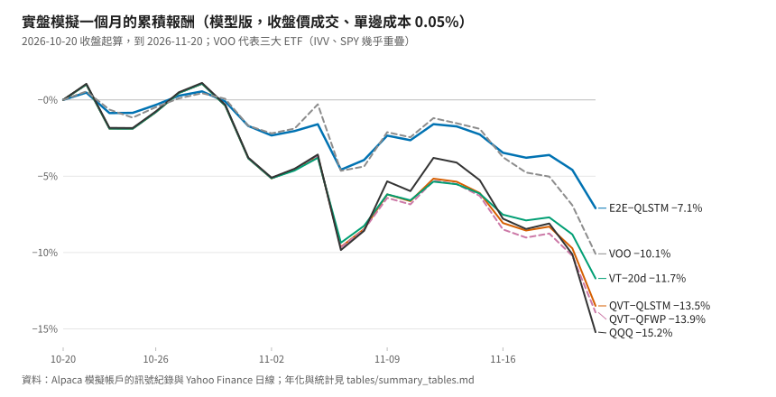
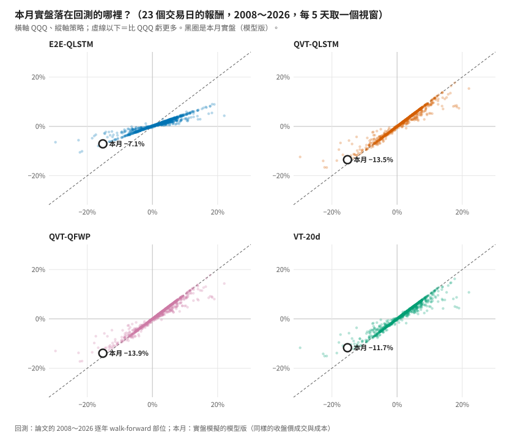

# 進度報告：實盤模擬一個月與延伸研究（2026-11-23）

資料到紐約時間 2026-11-20 收盤。詳細數字見 `README.md` 和 `tables/summary_tables.md`。

## 1. 三個重點

1. **實盤模擬的執行面已經驗證完成**：
   - 主要觀察期 21 個交易日已經跑完，目前累積 23 天；
   - 4 個策略、8 個 Alpaca 模擬帳戶，100 個訊號沒有錯過；
   - 券商帳戶和模型回測的差距約 0.2 個百分點。
2. **結果和論文的預測一致**：
   - 這段期間 QQQ 跌了 15.2%，4 個策略都比 QQQ 少虧；
   - 端到端量子模型（E2E-QLSTM）只虧了 QQQ 的一半左右（−7.1%），是唯一贏過 VOO、IVV、SPY 的策略；
   - 事先登記的 4 個預期全部符合；
   - 每個策略的結果都落在論文回測同類下跌的典型範圍內（第 58～75 百分位）。
3. **完成了以下延伸研究**：
   - 原論文的延伸與 3 種換資產的穩健性；
   - 讓模型專門學高波動日（方向 A）；
   - 什麼時候該用波動度目標、什麼時候該用均線（方向 B）；
   - 學長 RNR 台股論文的重驗，以及新的台股策略 M3F。
   - 共同的結論是：**「不大賠」來自波動度管理與趨勢濾網，量子模型沒有額外增益**。

## 2. 實盤模擬怎麼做

- **事先登記**：
  - 2026-10-21 第一筆單之前寫好 `PROTOCOL.md`，包括策略、成交規則、要報告的數字和預期結果；
  - 模型用論文 2026 年 fold 的模型，鎖定 SHA-256，觀察期間不重新訓練。
- **策略**：

  | 策略 | 部位怎麼決定 |
  |---|---|
  | E2E-QLSTM | 量子模型直接輸出 QQQ 部位 |
  | QVT-QLSTM、QVT-QFWP | 量子模型預測波動 σ̂，部位＝min(1, 20% ÷ σ̂) |
  | VT-20d | 用過去 20 天的波動，古典對照 |

- **成交方式**：
  - 每個策略各有「隔日開盤成交」和「收盤前 5 分鐘成交」兩個帳戶，用來量化成交時點的影響；
  - 另外用收盤價算一個「模型版」，和論文回測的算法相同。
- **自動化**：
  - 程式放在 GitHub Actions；
  - 由 cron-job.org 依紐約時間準時觸發，每個交易日自動執行，持續到 2026-12-15。

## 3. 結果

| 策略 | 模型版 | 券商：隔日開盤 | 券商：收盤前 | 虧損 ÷ QQQ 虧損 | 年化波動 |
|---|---|---|---|---|---|
| E2E-QLSTM | −7.09% | −7.27% | −6.14% | 0.47 | 17.8% |
| QVT-QLSTM | −13.50% | −13.68% | −11.63% | 0.89 | 33.0% |
| QVT-QFWP | −13.92% | −13.67% | −12.05% | 0.91 | 33.0% |
| VT-20d | −11.70% | −11.93% | −9.76% | 0.77 | 30.1% |
| VOO／IVV／SPY | −10.08%／−10.18%／−10.30% | | | 0.66～0.68 | 24.3%～24.8% |
| QQQ | −15.21% | | | 1.00 | 38.2% |

收盤前帳戶的數字比較好，是因為它們晚一天進場，避開了 10-22 的 −2.86%。用相同起點比較，三種成交方式只差 0.1～0.8 個百分點。

## 4. 和論文對照：哪些對上了、哪些還不能說

| 論文的說法 | 本月看到的 | 判斷 |
|---|---|---|
| 波動度目標在急跌時少虧 | 4 個策略的虧損是 QQQ 的 0.47～0.91 | 一致 |
| E2E-QLSTM 風險最低，危機中只虧 QQQ 的四分之一到一半 | 虧損是 QQQ 的 0.47，波動是 QQQ 的 47% | 一致；但見下面第 1 個注意事項 |
| 優勢來自波動度管理，不是量子 | 古典的 VT-20d（−11.7%）比兩個量子 QVT（−13.5%、−13.9%）少虧 | 一致 |
| 量子模型的預測太平滑，減碼較慢（延伸研究） | 10-29 以後量子 σ̂ 平均比過去 20 天波動低 5 個百分點，部位多 10～11 個百分點 | 一致 |
| 回測和實際執行差距小 | 約 0.2 個百分點，遠小於策略之間的 6.8 個百分點 | 一致 |
| 長期、風險調整後勝過三大 ETF（2008～2026 CAGR÷波動 0.85 對 SPY 0.57） | 一個月無法檢驗。本月 QVT 輸給三大 ETF；回測中 QQQ 急跌時，QVT 也只有約 56% 贏 SPY | 無法檢驗，但符合回測行為 |

### 需要老實說明的兩點

1. **E2E-QLSTM 的部位整個月幾乎固定在 46%～47%。**
   - 同期固定持有 46.6% QQQ、其餘放 BIL，結果幾乎一樣（−7.07% 對 −7.09%）。
   - 回測裡 19 年有 15 年，E2E 年內部位的高低差不到 3 個百分點；2020 年崩盤、2022 年熊市時部位都維持在 47% 左右。只有 2008、2011、2018、2025 年在年內明顯減碼。
   - 所以 E2E「少虧一半」主要來自**持有比例低**，擇時的成分很少。
   - 不過回測全期它還是比「固定持有 41%（它的平均部位）」好：CAGR÷波動 0.97 對 0.85，最大回撤 −17% 對 −23%。這部分來自每年重新訓練後部位水準的改變。
2. **一個月只能驗證「執行面」和「下跌時的行為」**。
   - 統計上不能做任何勝負結論，事先登記就寫明了；
   - 這個月是科技股領跌，看不到上漲時少賺的代價。

## 5. 延伸研究摘要（詳見 `EXTENSIONS.md`）

| 研究 | 問的問題 | 結果 | 建議放在哪裡 |
|---|---|---|---|
| 原論文延伸＋穩健性（個股、期貨、多資產 52 年） | 波動度管理換資產、換期間還成立嗎？ | 4 種情境的最大回撤都少了三成到三分之二；只有原論文的 QQQ 結果顯著；量子在 5 處都沒有額外增益 | 完整版論文 |
| 方向 A：讓模型專門學高波動日 | 改用針對決策的損失，策略會變好嗎？ | 81 個主要檢定 0 個通過。找到根源：log 尺度訓練讓波動被低估 22%～30% | 完整版論文的一小節 |
| 方向 B：下跌速度與工具選擇 | 什麼時候用波動度目標、什麼時候用均線？ | 事前選工具的規則在沒看過的資料上失敗。兩地「不大賠」主要靠均線 | 完整版論文的討論段落 |
| RNR 台股論文重驗 | 學長論文的 85% 準確率能重現嗎？ | 照公開描述重做無法重現，4 個假設都不成立 | 台灣論文 |
| M3F 新策略（均線＋外資） | 台股能「不大賠」嗎？ | 用 0050 實際執行，最大回撤 −19.6%，0050 是 −33.6%（Holm p＝0.038）；但擇時本身的價值沒有被證實 | 台灣論文 |

## 6. 想請教老師的問題

1. **ICASSP 研討會版**：
   - 要不要加一句實盤模擬的結果？
   - 「量子沒有額外增益」的定位要怎麼寫比較好？
2. **完整版論文**：要不要放這三樣？投哪裡比較適合？
   - 實盤模擬一節；
   - 方向 A（決策型損失，約半頁）；
   - 方向 B（討論段落）。
3. **實盤模擬的後續**：
   - 12-15 之後要不要延長，例如到 2027 年第一季，涵蓋一段上漲？
   - 要不要補一個「固定 47% QQQ」的對照帳戶？
4. **台灣論文**：重驗結果和學長的論文不一致，要怎麼處理比較恰當？例如先私下和學長討論，再決定怎麼寫。
5. **下一個量子方向**：
   - 想做 E2E-QLSTM 在其他市場的重現，以及「為什麼它不會過擬合」。
   - 目前的線索是它大部分時間輸出接近固定的部位。老師覺得值得做嗎？
